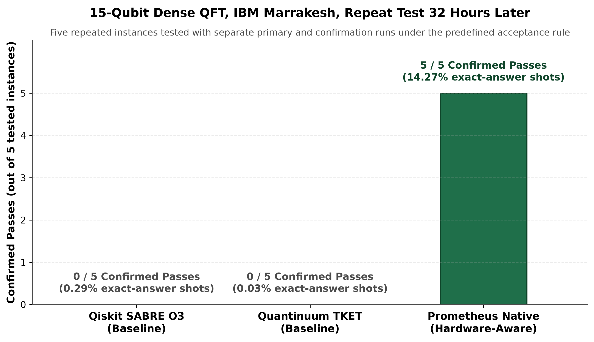

# Practical Quantum Execution Limits Across Processors and Time

*Explore the portfolio: [Prometheus Quantum Overview](https://github.com/PrometheusDynamicsCanada/prometheus-quantum-overview)*

**We tested how difficult quantum circuits could become before their results stopped meeting a predefined quality requirement. Prometheus kept selected dense workloads usable where the tested baselines failed.**

Execution software matters most near a processor's operating limit, where extra routing gates determine whether a difficult workload meets its predefined quality requirement. Every `Confirmed Pass` required clearing the target threshold in both a primary run and a separate confirmation run:

- **IBM Marrakesh (`15`-qubit dense QFT):** Prometheus passed all **`10/10` fresh instances** while Qiskit SABRE and Quantinuum TKET passed **`0/10`**. Tested again **32 hours later** on five paired instances, `Prometheus Native` repeated **`5/5` confirmed passes** (`14.27%` vs. `0.29%` SABRE exact-answer probability per shot) while both baselines passed **`0/5`**.
- **IQM Emerald (`12`-qubit dense QFT):** On a square-lattice processor, Prometheus passed **`5/5` instances** vs. **`0/5`** for both baselines.
- **Disclosed limits:** Unresolved outcomes at `16-17` qubits and on `ibm_fez`, as well as mixed-regime ties (`7/28` overall passes in the coarse sweep), are reported alongside these wins.

**[Detailed results](#2-complete-boundary-portability-and-unresolved-results) · [Verify the evidence](#verify-the-evidence) · [Discuss a pilot](#discuss-a-pilot)**


*Opening summary (`Stage 5.3B` repeat test 32 hours after `Stage 5.2` on `ibm_marrakesh`, same published `2026-11-13` calibration record): Five repeated 15-qubit dense QFT instances were tested with separate primary and confirmation runs under the predefined acceptance rule (`bit polarization >= 0.50` + exact majority-vote recovery). `Prometheus Native` passed `5/5`; Qiskit SABRE O3 and Quantinuum TKET passed `0/5`.*

---

## 1. Executive Summary & Principal Comparative Benchmark Table

> [!NOTE]
> **Accounting, Metric & Verification Conventions (`python scripts/verify_practical_limits_campaign.py`):**
> - **Verification Kind (Raw-Histogram Reconstruction):** Standalone `numpy`-only verifier recomputes all `1,648` PUB scores, `6` universal observables, and two-wave `MECE` classifications directly from the published raw bitstring histograms (`max diff = 0.00e+00`).
> - **Unique Logical Workloads (`129`) vs. Physical Executions (`1,648` PUBs):** `129` unique logical circuits (`56` Stage 5.1 + `60` fresh Stage 5.2 + `13` Emerald-only Stage 5.5) evaluated across `206` stage-level 4-arm x 2-wave comparisons = `824` compiled physical circuits, `1,648` physical PUBs, and `1,687,552` physical shots ([`DATA_DICTIONARY.md`](DATA_DICTIONARY.md)).
> - **Explicit Metric Definitions:** Classical Bhattacharyya Overlap is $F_B = \sum_x \sqrt{P_{\text{ideal}}(x) P_{\text{meas}}(x)}$ (labeled `"State Fidelity"` in Studio UIs); Squared Hellinger Fidelity is $F_H = F_B^2$. On deterministic single-target `F2_QFT_PhaseRecovery`, $F_H = \text{HOP} = P_{\text{meas}}(z^*)$ equals **exact complete-answer probability per shot** (never `"Nx fidelity"`). Primary metrics are never averaged across circuit families, and majority-vote recoveries are kept separate from strict two-wave `Confirmed Pass` counts.

### Table 1A: Headline Multi-Processor & Multi-Window Dense QFT Comparisons (`F2_QFT_PhaseRecovery`, Acceptance Rule: $\mathcal{P}_{\text{bit}} \ge 0.50$ + Majority Vote in Both Waves)

| Stage, Processor & Hardware Job IDs (`Unique Instances`, `PUBs`, `Shots`) | Execution Strategy (`CPU Budget`) | Primary $\mathcal{P}_{\text{bit}}$ `*(mean)*` \| `*(median)*` `(↑)` (`% Delta` vs. Best Baseline) | Both-Wave Majority Vote \| Strict `Pass/Unres/Fail` (`Aggregate MECE`) | Exact-Answer Prob. $P(z^*) = F_H$ `(↑)` \| Overlap $F_B$ `(↑)` `*(mean)*` | $\text{TVD}$ `(↓)` \| $\text{XEB}$ `(↑)` \| Entropy $H$ `(bits)` `*(mean)*` | Native 2Q `(↓)` \| Depth `(↓)` `*(mean)*` (`Structural % Delta` vs. Best Baseline) |
| :--- | :--- | :---: | :---: | :---: | :---: | :---: |
| **Stage 5.2 (`ibm_marrakesh` W1): `15Q` Dense QFT**<br>`6` Jobs: `dbta4g7a...` to `dbta5ava...`<br>(`N = 10` fresh `s2..s11`, `80` PUBs, `81,920` shots) | `SABRE O3 (1.0x)`<br>`TKET (1.0x)`<br>`Prom. Native (1.0x)`<br>**`Prom. Selector (3.0x)`** | `0.3271 \| 0.3252` (`0.0%`)<br>`0.1007 \| 0.1114` (`-69.2%`)<br>`0.5725 \| 0.5714` (`+75.0%`)<br>**`0.5778 \| 0.5790` (`+76.6%`)** | `1/10` \| `0/0/10` (`Confirmed Fail`)<br>`0/10` \| `0/0/10` (`Confirmed Fail`)<br>**`10/10` \| `10/0/0` (`Confirmed Pass`)**<br>**`10/10` \| `10/0/0` (`Confirmed Pass`)** | `1.01% \| 0.0937`<br>`0.04% \| 0.0131`<br>`13.24% \| 0.3632`<br>**`13.77% \| 0.3703`** | `0.9899 \| 328.6 \| 9.548`<br>`0.9996 \| 13.4 \| 9.931`<br>`0.8676 \| 4336.6 \| 7.885`<br>**`0.8623 \| 4511.0 \| 7.853`** | `330.6 \| 436.1` (`0.0% / 0.0%`)<br>`714.0 \| 1132.0` (`+116.0% / +159.6%`)<br>**`314.0 \| 300.0` (`-5.0% / -31.2%`)**<br>**`314.0 \| 300.0` (`-5.0% / -31.2%`)** |
| **Stage 5.3B (`ibm_marrakesh` W2 `+32h`): `15Q` Dense QFT**<br>`4` Jobs: `dbu6cvc9...` to `dbu6elae...`<br>(`N = 5` paired `s2..s6`, `40` PUBs, `40,960` shots) | `SABRE O3 (1.0x)`<br>`TKET (1.0x)`<br>**`Prom. Native (1.0x)`**<br>`Prom. Selector (3.0x)` | `0.2549 \| 0.2551` (`0.0%`)<br>`0.1125 \| 0.1116` (`-55.9%`)<br>**`0.5659 \| 0.5693` (`+122.0%`)**<br>`0.5613 \| 0.5602` (`+120.2%`) | `0/5` \| `0/0/5` (`Confirmed Fail`)<br>`0/5` \| `0/0/5` (`Confirmed Fail`)<br>**`5/5` \| `5/0/0` (`Confirmed Pass`)**<br>**`5/5`** \| `4/1/0` (**`Confirmed Pass`**) | `0.29% \| 0.0524`<br>`0.03% \| 0.0075`<br>`14.27% \| 0.3767`<br>**`14.41% \| 0.3786`** | `0.9971 \| 95.0 \| 9.729`<br>`0.9997 \| 8.6 \| 9.904`<br>`0.8573 \| 4674.2 \|` **`7.906`**<br>**`0.8559 \| 4722.2`** `\| 7.917` | `340.2 \| 449.6` (`0.0% / 0.0%`)<br>`702.0 \| 1207.0` (`+106.3% / +168.5%`)<br>**`314.0 \| 300.0` (`-7.7% / -33.3%`)**<br>**`314.0 \| 300.0` (`-7.7% / -33.3%`)** |
| **Stage 5.5 (`IQM Emerald` `54Q`): `12Q` Dense QFT**<br>`4` Jobs: `01a1e32d-...` to `01a1e32f-...`<br>(`N = 5` `s0..s4`, `40` PUBs, `40,960` shots) | `SABRE O3 (1.0x)`<br>`TKET (1.0x)`<br>`Prom. Native (1.0x)`<br>**`Prom. Selector (3.0x)`** | `0.3398 \| 0.3409` (`0.0%`)<br>`0.0698 \| 0.0682` (`-79.5%`)<br>`0.5797 \| 0.5808` (`+70.6%`)<br>**`0.5813 \| 0.5815` (`+71.1%`)** | `3/5` \| `0/0/5` (`Confirmed Fail`)<br>`0/5` \| `0/0/5` (`Confirmed Fail`)<br>**`5/5` \| `5/0/0` (`Confirmed Pass`)**<br>**`5/5` \| `5/0/0` (`Confirmed Pass`)** | `3.00% \| 0.1644`<br>`0.06% \| 0.0151`<br>**`17.68% \| 0.4199`**<br>`17.47% \| 0.4177` | `0.9700 \| 121.8 \| 8.902`<br>`0.9994 \| 1.4 \| 9.629`<br>**`0.8232 \| 723.0`** `\| 7.113`<br>`0.8253 \| 714.6 \|` **`7.088`** | `201.8 \| 284.2` (`0.0% / 0.0%`)<br>`318.0 \| 472.0` (`+57.6% / +66.1%`)<br>**`197.0 \| 191.0` (`-2.4% / -32.8%`)**<br>**`197.0 \| 191.0` (`-2.4% / -32.8%`)** |
| **Stage 5.3A (`ibm_fez` Portability): `15Q` Dense QFT**<br>`4` Jobs: `dbtbc89v...` to `dbtgpepv...`<br>(`N = 5` paired `s2..s6`, `40` PUBs, `40,960` shots) | `SABRE O3 (1.0x)`<br>`TKET (1.0x)`<br>**`Prom. Native (1.0x)`**<br>`Prom. Selector (3.0x)` | `0.2193 \| 0.2065` (`0.0%`)<br>`0.1122 \| 0.1255` (`-48.8%`)<br>**`0.5135 \| 0.5131` (`+134.2%`)**<br>`0.5006 \| 0.5085` (`+128.3%`) | `0/5` \| `0/0/5` (`Confirmed Fail`)<br>`0/5` \| `0/0/5` (`Confirmed Fail`)<br>**`5/5` \| `1/4/0` (`Unresolved`)**<br>**`5/5`** \| `0/4/1` (`Unresolved`) | `0.39% \| 0.0533`<br>`0.08% \| 0.0192`<br>**`10.56% \| 0.3240`**<br>`10.13% \| 0.3179` | `0.9961 \| 127.0 \| 9.804`<br>`0.9992 \| 24.6 \| 9.922`<br>**`0.8944 \| 3458.2 \| 8.388`**<br>`0.8987 \| 3317.4 \| 8.469` | `340.2 \| 449.2` (`0.0% / 0.0%`)<br>`708.0 \| 1232.2` (`+108.1% / +174.3%`)<br>**`314.0 \| 300.0` (`-7.7% / -33.2%`)**<br>**`314.0 \| 300.0` (`-7.7% / -33.2%`)** |

---

## 2. Complete Boundary, Portability, and Unresolved Results

Every unresolved, marginal, and failed benchmark point across all five stages is reported alongside the confirmed passes (with full multi-panel technical figures inside the expandable block below):

### Table 2A: All 6 Boundary Points Across `ibm_marrakesh` (`W1` $N=10$, `W2 +32h` $N=5$) and `ibm_fez` (`N=5`)

| Boundary Point & Threshold | Cohort (`Processor`, `Window`, `N`) | `SABRE O3` `*(mean)*` (`P/U/F`, `MECE`) | `TKET` `*(mean)*` (`P/U/F`, `MECE`) | `Prometheus Native` `*(mean)*` (`P/U/F`, `MECE`) | `Prometheus Selector` `*(mean)*` (`P/U/F`, `MECE`) |
| :--- | :--- | :---: | :---: | :---: | :---: |
| **`B1`: `14Q` Dense QFT**<br>($\mathcal{P}_{\text{bit}} \ge 0.50$ + MV) | `ibm_marrakesh` W1 (`N=10`)<br>`ibm_marrakesh` W2 `+32h` (`N=5`)<br>`ibm_fez` (`N=5`) | `0.4376` (`1/4/5`, `Unresolved`)<br>`0.3205` (`0/0/5`, `Fail`)<br>`0.2893` (`0/0/5`, `Fail`) | `0.0955` (`0/0/10`, `Fail`)<br>`0.2141` (`0/0/5`, `Fail`)<br>`0.1885` (`0/0/5`, `Fail`) | `0.6369` (**`10/0/0`, `Pass`**)<br>**`0.5381` (`4/1/0`, `Pass`)**<br>`0.4678` (`0/5/0`, `Unresolved`) | **`0.6408` (`10/0/0`, `Pass`)**<br>`0.5377` (**`4/1/0`, `Pass`**)<br>**`0.4849`** (`0/5/0`, `Unresolved`) |
| **`B2`: `15Q` Dense QFT**<br>($\mathcal{P}_{\text{bit}} \ge 0.50$ + MV) | `ibm_marrakesh` W1 (`N=10`)<br>`ibm_marrakesh` W2 `+32h` (`N=5`)<br>`ibm_fez` (`N=5`) | `0.3271` (`0/0/10`, `Fail`)<br>`0.2549` (`0/0/5`, `Fail`)<br>`0.2193` (`0/0/5`, `Fail`) | `0.1007` (`0/0/10`, `Fail`)<br>`0.1125` (`0/0/5`, `Fail`)<br>`0.1122` (`0/0/5`, `Fail`) | `0.5725` (**`10/0/0`, `Pass`**)<br>**`0.5659` (`5/0/0`, `Pass`)**<br>**`0.5135` (`1/4/0`, `Unresolved`)** | **`0.5778` (`10/0/0`, `Pass`)**<br>`0.5613` (`4/1/0`, **`Pass`**)<br>`0.5006` (`0/4/1`, `Unresolved`) |
| **`B3`: `16Q` Dense QFT**<br>($\mathcal{P}_{\text{bit}} \ge 0.50$ + MV) | `ibm_marrakesh` W1 (`N=10`)<br>`ibm_marrakesh` W2 `+32h` (`N=5`)<br>`ibm_fez` (`N=5`) | `0.4078` (`0/0/10`, `Fail`)<br>`0.2192` (`0/0/5`, `Fail`)<br>`0.2229` (`0/0/5`, `Fail`) | `-0.0033` (`0/0/10`, `Fail`)<br>`0.0793` (`0/0/5`, `Fail`)<br>`0.0632` (`0/0/5`, `Fail`) | **`0.5555` (`9/1/0`, `Pass`)**<br>**`0.5346`** (`2/3/0`, `Unresolved`)<br>**`0.4401`** (`0/1/4`, `Unresolved`) | `0.5517` (`7/3/0`, **`Pass`**)<br>`0.5290` (**`3/2/0`, `Pass`**)<br>**`0.4401`** (`0/1/4`, `Fail`) |
| **`B4`: `17Q` Dense QFT**<br>($\mathcal{P}_{\text{bit}} \ge 0.50$ + MV) | `ibm_marrakesh` W1 (`N=10`)<br>`ibm_marrakesh` W2 `+32h` (`N=5`)<br>`ibm_fez` (`N=5`) | `0.3562` (`0/0/10`, `Fail`)<br>`0.1791` (`0/0/5`, `Fail`)<br>`0.2002` (`0/0/5`, `Fail`) | `0.1304` (`0/0/10`, `Fail`)<br>`0.1359` (`0/0/5`, `Fail`)<br>`0.0801` (`0/0/5`, `Fail`) | **`0.5411`** (`6/4/0`, **`Pass`**)<br>**`0.5285`** (`2/3/0`, `Unresolved`)<br>**`0.3978`** (`0/0/5`, `Fail`) | `0.5406` (**`7/3/0`, `Pass`**)<br>`0.5240` (`2/3/0`, `Unresolved`)<br>`0.3969` (`0/0/5`, `Fail`) |
| **`B5`: `10Q` Dense QAOA**<br>($r_{\text{approx}} \ge 0.35$, $L=2$) | `ibm_marrakesh` W1 (`N=10`)<br>`ibm_marrakesh` W2 `+32h` (`N=5`)<br>`ibm_fez` (`N=5`) | `0.1485` (`0/0/10`, `Fail`)<br>`0.2093` (`0/0/5`, `Fail`)<br>`0.1663` (`0/0/5`, `Fail`) | `0.2140` (`0/0/10`, `Fail`)<br>`0.2044` (`0/0/5`, `Fail`)<br>`0.1394` (`0/0/5`, `Fail`) | **`0.2575`** (`0/0/10`, `Fail`)<br>**`0.3868` (`2/3/0`, `Unresolved`)**<br>`0.3240` (`0/4/1`, `Unresolved`) | `0.2554` (`0/0/10`, `Fail`)<br>`0.3851` (**`2/3/0`, `Unresolved`**)<br>**`0.3274` (`0/5/0`, `Unresolved`)** |
| **`B6`: `15Q` Sparse `SU(4)`**<br>($\text{HOP} \ge 0.58$, $L=2$) | `ibm_marrakesh` W1 (`N=10`)<br>`ibm_marrakesh` W2 `+32h` (`N=5`)<br>`ibm_fez` (`N=5`) | `0.5996` (`5/3/2`, `Unresolved`)<br>`0.6083` (`1/4/0`, `Unresolved`)<br>**`0.6212`** (`2/3/0`, `Unresolved`) | `0.5324` (`0/3/7`, `Fail`)<br>`0.5317` (`0/2/3`, `Fail`)<br>`0.5307` (`0/3/2`, `Unresolved`) | **`0.6246`** (`4/6/0`, `Unresolved`)<br>`0.6175` (`1/4/0`, `Unresolved`)<br>`0.6168` (`1/4/0`, `Unresolved`) | `0.6103` (**`7/2/1`**, `Unresolved`)<br>**`0.6228`** (`1/4/0`, `Unresolved`)<br>`0.6153` (**`3/2/0`**, `Unresolved`) |

### Table 2B: All 6 Points on `54Q` `IQM Emerald` (`Stage 5.5`, Square Lattice, `N = 5` Instances `s0..s4` / Point, `240` PUBs, `245,760` Shots)

| Point & Workload (`Threshold`) | `SABRE O3` `*(mean)*` (`P/U/F`, `MECE`) | `TKET` `*(mean)*` (`P/U/F`, `MECE`) | `Prometheus Native` `*(mean)*` (`P/U/F`, `MECE`) | `Prometheus Selector` `*(mean)*` (`P/U/F`, `MECE`) | Native 2Q \| Depth vs. `SABRE` `(↓)` |
| :--- | :---: | :---: | :---: | :---: | :---: |
| **`E1`: `12Q` Dense QFT** ($\mathcal{P}_{\text{bit}} \ge 0.50$) | `0.3398` (`0/0/5`, `Confirmed Fail`) | `0.0698` (`0/0/5`, `Confirmed Fail`) | `0.5797` (**`5/0/0`, `Confirmed Pass`**) | **`0.5813` (`5/0/0`, `Confirmed Pass`)** | **`197.0 \| 191.0`** vs. `201.8 \| 284.2` (`-2.4% / -32.8%`) |
| **`E2`: `14Q` Dense QFT** ($\mathcal{P}_{\text{bit}} \ge 0.50$) | `0.3111` (`0/0/5`, `Confirmed Fail`) | `0.1005` (`0/0/5`, `Confirmed Fail`) | `0.4557` (**`0/2/3`, `Unresolved`**) | **`0.4597`** (`0/1/4`, `Confirmed Fail`) | `272.0 \|` **`227.0`** vs. **`264.4`** `\| 297.2` (`+2.9% / -23.6%`) |
| **`E3`: `15Q` Dense QFT** ($\mathcal{P}_{\text{bit}} \ge 0.50$) | `0.2446` (`0/0/5`, `Confirmed Fail`) | `0.0646` (`0/0/5`, `Confirmed Fail`) | **`0.4234`** (`0/0/5`, `Confirmed Fail`) | `0.4197` (`0/0/5`, `Confirmed Fail`) | `314.0 \|` **`245.0`** vs. **`311.8`** `\| 359.8` (`+0.7% / -31.9%`) |
| **`E4`: `16Q` Dense QFT** ($\mathcal{P}_{\text{bit}} \ge 0.50$) | `0.2404` (`0/0/5`, `Confirmed Fail`) | `0.0636` (`0/0/5`, `Confirmed Fail`) | **`0.4517` (`0/2/3`, `Confirmed Fail`)** | `0.4467` (`0/1/4`, `Confirmed Fail`) | `359.0 \|` **`263.0`** vs. **`354.6`** `\| 340.0` (`+1.2% / -22.6%`) |
| **`E5`: `15Q` Local Path QAOA** ($r_{\text{approx}} \ge 0.35$, $L=2$) | `0.6089` (**`5/0/0`, `Confirmed Pass`**) | **`0.6427` (`5/0/0`, `Confirmed Pass`)** | `0.6263` (**`5/0/0`, `Confirmed Pass`**) | `0.6251` (**`5/0/0`, `Confirmed Pass`**) | **`56.0 \| 33.0`** vs. **`56.0 \| 33.0`** (`0.0% / 0.0%`, `0` SWAPs) |
| **`E6`: `9Q` Dense QAOA** ($r_{\text{approx}} \ge 0.35$, $L=2$) | `0.2059` (`0/0/5`, `Confirmed Fail`) | `0.1495` (`0/0/5`, `Confirmed Fail`) | **`0.2965` (`0/1/4`, `Confirmed Fail`)** | `0.2935` (**`0/1/4`**, `Confirmed Fail`) | **`200.0 \| 152.6`** vs. `226.6 \| 279.6` (`-11.7% / -45.4%`) |

<details>
<summary><strong>Expand Technical Campaign Figures (Multi-Width Operating Curves, Cross-Processor Means, and Stage 5.1 28-Point Sweep)</strong></summary>

*Note: Mean polarization curves illustrate signal trends across widths, whereas `Confirmed Pass` claims require instance-level two-wave 95% confidence intervals above threshold.*


</details>

---

## Verify the Evidence

**Verification Kind:** Direct **raw-measurement histogram reconstruction** (`numpy` only, zero Qiskit or proprietary dependencies). Recomputes all `1,648` PUB primary metrics, universal distribution observables, and two-wave `MECE` classifications directly from `data/raw_counts/*.json` (`max diff = 0.00e+00`) and verifies all `129` unrouted OpenQASM 2.0 circuits (`data/logical_workloads/`):

```bash
python scripts/verify_practical_limits_campaign.py
```

- **Key files:** [`data/ALL_1648_EXECUTIONS_MASTER_LEDGER.csv`](data/ALL_1648_EXECUTIONS_MASTER_LEDGER.csv) · [`DATA_DICTIONARY.md`](DATA_DICTIONARY.md) · [`PUBLIC_DISCLOSURE.md`](PUBLIC_DISCLOSURE.md) · [`REPO_SHA256_MANIFEST.json`](REPO_SHA256_MANIFEST.json)

---

## Discuss a Pilot

**Bring a representative workload and an acceptance criterion. We can compare Prometheus with your existing execution approach and measure quality, acceptance rate and charged hardware resources.**

- **Contact:** [william@prometheusdynamics.ca](mailto:william@prometheusdynamics.ca) | [prometheusdynamics.ca](https://prometheusdynamics.ca)
