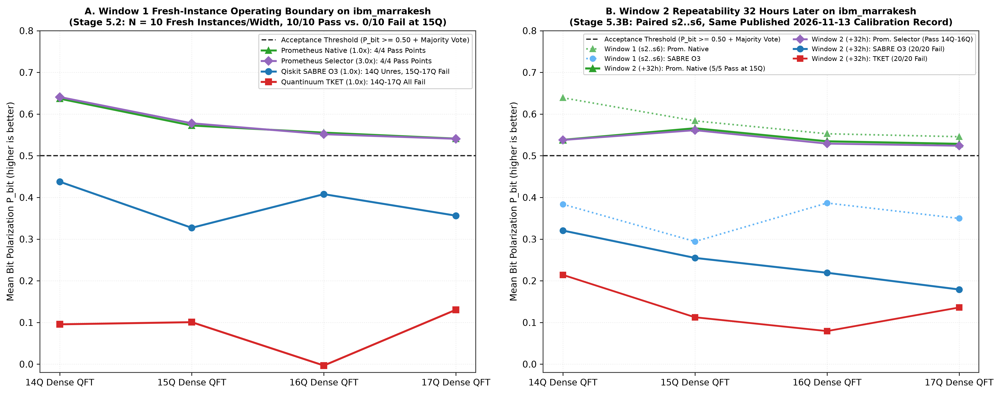
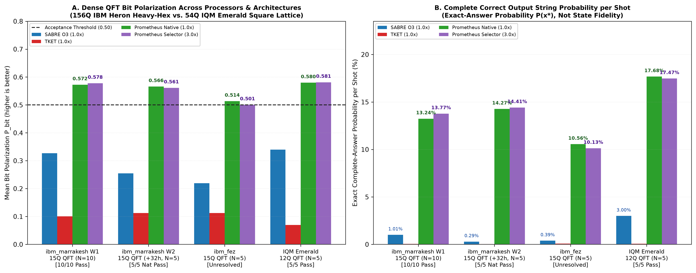
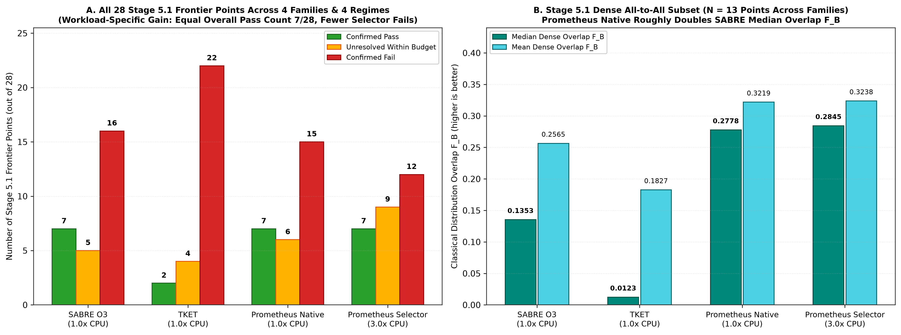

# Practical Execution Limits Across Processors & Time

*Portfolio Hub: [Prometheus Quantum Overview](https://github.com/PrometheusDynamicsCanada/prometheus-quantum-overview) · [1,648-PUB Master Ledger](data/ALL_1648_EXECUTIONS_MASTER_LEDGER.csv) · [Data Dictionary](DATA_DICTIONARY.md)*

**Near a processor's operating limit, Prometheus kept 15-qubit IBM and 12-qubit IQM dense Fourier circuits passing strict two-wave checks where Qiskit SABRE and Quantinuum TKET passed 0.**

## At a Glance

- **Strict acceptance rule:** Every `Confirmed Pass` required bit polarization `>= 0.50` plus exact majority-vote recovery in **both** primary and confirmation waves.
- **IBM Marrakesh (`15Q` Dense QFT):** **`10/10` fresh passes** (`0/10` SABRE & TKET), and **`5/5` confirmed passes 32 hours later** (`14.27%` vs. `0.29%` SABRE exact-answer probability per shot).
- **IQM Emerald (`12Q` Dense QFT):** **`5/5` confirmed passes** on square-lattice hardware vs. **`0/5`** for both baselines.
- **Disclosed limits (`24` jobs, `1,648` PUBs, `1.69M` shots):** Unresolved/failed boundaries at `16Q-17Q` and on `ibm_fez` (`1/4/0` unresolved at `15Q`) are reported openly below.

*Repeat test 32 hours later on `ibm_marrakesh` (`15Q` Dense QFT): Prometheus Native passed `5/5` dual-wave checks; SABRE O3 and TKET passed `0/5`.*

---

## Executive Summary (`15Q` IBM Marrakesh Fresh & `+32h` + `12Q` IQM Emerald Dense QFT)

*Hardware IDs:* Marrakesh W1 `dbta4g7a..`..`dbta5ava..` (`6` jobs, `81,920` shots), Marrakesh `+32h` `dbu6cvc9..`..`dbu6elae..` (`4` jobs, `40,960` shots), Emerald `01a1e32d-..`..`01a1e32f-..` (`4` jobs, `40,960` shots). `*(mean)*` observables shown:

| Cohort & Strategy | Confirmed Passes `(↑)` | Polarization `(↑)` | Exact Prob $P(z^*) = F_H$ `(↑)` | Overlap $F_B$ `(↑)` | `TVD` `(↓)` | `XEB` `(↑)` | Entropy `(↓)` | `2Q` Gates / Depth `(↓)` |
| :--- | :---: | :---: | :---: | :---: | :---: | :---: | :---: | :---: |
| **`15Q` Marrakesh W1: SABRE O3** | `0 / 10` | `0.3271` | `1.01%` | `0.0937` | `0.9899` | `328.6` | `9.55` | `330.6` / `436.1` |
| **`15Q` Marrakesh W1: TKET** | `0 / 10` | `0.1007` | `0.04%` | `0.0131` | `0.9996` | `13.4` | `9.93` | `714.0` / `1132.0` |
| **`15Q` Marrakesh W1: Prometheus** | **`10 / 10`** | **`0.5778`** (`+76.6%`) | **`13.77%`** | **`0.3703`** | **`0.8623`** | **`4511.0`** | **`7.85`** | **`314.0` / `300.0`** (`-31.2%` depth) |
| **`15Q` Marrakesh `+32h`: SABRE O3** | `0 / 5` | `0.2549` | `0.29%` | `0.0524` | `0.9971` | `95.0` | `9.73` | `340.2` / `449.6` |
| **`15Q` Marrakesh `+32h`: TKET** | `0 / 5` | `0.1125` | `0.03%` | `0.0075` | `0.9997` | `8.6` | `9.90` | `702.0` / `1207.0` |
| **`15Q` Marrakesh `+32h`: Prom Native** | **`5 / 5`** | **`0.5659`** (`+122.0%`) | **`14.27%`** | **`0.3767`** | **`0.8573`** | **`4674.2`** | **`7.91`** | **`314.0` / `300.0`** (`-33.3%` depth) |
| **`12Q` IQM Emerald: SABRE O3** | `0 / 5` | `0.3398` | `3.00%` | `0.1644` | `0.9700` | `121.8` | `8.90` | `201.8` / `284.2` |
| **`12Q` IQM Emerald: TKET** | `0 / 5` | `0.0698` | `0.06%` | `0.0151` | `0.9994` | `1.4` | `9.63` | `318.0` / `472.0` |
| **`12Q` IQM Emerald: Prometheus** | **`5 / 5`** | **`0.5813`** (`+71.1%`) | **`17.47%`** (`17.68%` Nat) | **`0.4177`** | **`0.8253`** | **`714.6`** | **`7.09`** | **`197.0` / `191.0`** (`-32.8%` depth) |

*Metric Key:* On single-target `F2_QFT_PhaseRecovery`, $F_H = F_B^2 = \text{HOP} = P_{\text{meas}}(z^*)$ is exact complete-answer probability per shot.

- **Offline `numpy` raw-histogram verifier (`1,648` PUBs, `0.00e+00` max diff):** `python scripts/verify_practical_limits_campaign.py`
- **Start a supported pilot:** [william@prometheusdynamics.ca](mailto:william@prometheusdynamics.ca) | [prometheusdynamics.ca](https://prometheusdynamics.ca)

---

## Complete Portability, Boundary & Unresolved Results (`14Q-17Q`, `ibm_fez`, `IQM Emerald`)

<strong>1. All Boundary Points Across ibm_marrakesh, ibm_fez (Stage 5.3A), and IQM Emerald (Stage 5.5) - Click to expand</strong>

### `Stage 5.3A` Portability Check (`ibm_fez`, `15Q` Dense QFT, `4` Jobs `dbtbc89v..`..`dbtgpepv..`, `N = 5`, `40` PUBs, `40,960` Shots)
- `SABRE O3`: Pol `0.2193` `*(mean)*` / `0.2065` `*(med)*`, `0/0/5` (`Fail`), $F_H$ `0.39%`, $F_B$ `0.0533`, `TVD` `0.9961`, `XEB` `127.0`, `2Q/Depth` `340.2 / 449.2`.
- `TKET`: Pol `0.1122` `*(mean)*` / `0.1255` `*(med)*`, `0/0/5` (`Fail`), $F_H$ `0.08%`, $F_B$ `0.0192`, `TVD` `0.9992`, `XEB` `24.6`, `2Q/Depth` `708.0 / 1232.2`.
- **`Prometheus Native`**: Pol **`0.5135`** `*(mean)*` / **`0.5131`** `*(med)*` (`+134.2%`), **`5/5` majority vote**, strict `1/4/0` (`Unresolved`), $F_H$ **`10.56%`**, $F_B$ **`0.3240`**, `TVD` **`0.8944`**, `XEB` **`3458.2`**, `2Q/Depth` **`314.0 / 300.0`**. (`Prom Selector`: Pol `0.5006`, `0/4/1` `Unresolved`.)

### All 6 Boundary Points (`B1`-`B6`: `Pass / Unresolved / Fail` Counts)

| Point & Threshold | Cohort (`Processor`, `N`) | `SABRE O3` `*(mean)*` (`P/U/F`) | `TKET` `*(mean)*` (`P/U/F`) | `Prom Native` `*(mean)*` (`P/U/F`) | `Prom Selector` `*(mean)*` (`P/U/F`) |
| :--- | :--- | :---: | :---: | :---: | :---: |
| **`B1`: `14Q` Dense QFT** (`>= 0.50`) | `marrakesh` W1 (`10`) / `+32h` (`5`) / `fez` (`5`) | `0.438` (`1/4/5`) · `0.321` (`0/0/5`) · `0.289` (`0/0/5`) | `0.096` (`0/0/10`) · `0.214` (`0/0/5`) · `0.189` (`0/0/5`) | `0.637` (**`10/0/0`**) · **`0.538` (`4/1/0`)** · `0.468` (`0/5/0`) | **`0.641` (`10/0/0`)** · `0.538` (**`4/1/0`**) · **`0.485`** (`0/5/0`) |
| **`B2`: `15Q` Dense QFT** (`>= 0.50`) | `marrakesh` W1 (`10`) / `+32h` (`5`) / `fez` (`5`) | `0.327` (`0/0/10`) · `0.255` (`0/0/5`) · `0.219` (`0/0/5`) | `0.101` (`0/0/10`) · `0.113` (`0/0/5`) · `0.112` (`0/0/5`) | `0.573` (**`10/0/0`**) · **`0.566` (`5/0/0`)** · **`0.514`** (`1/4/0`) | **`0.578` (`10/0/0`)** · `0.561` (`4/1/0`) · `0.501` (`0/4/1`) |
| **`B3`: `16Q` Dense QFT** (`>= 0.50`) | `marrakesh` W1 (`10`) / `+32h` (`5`) / `fez` (`5`) | `0.408` (`0/0/10`) · `0.219` (`0/0/5`) · `0.223` (`0/0/5`) | `-0.003` (`0/0/10`) · `0.079` (`0/0/5`) · `0.063` (`0/0/5`) | **`0.556` (`9/1/0`)** · **`0.535`** (`2/3/0`) · **`0.440`** (`0/1/4`) | `0.552` (`7/3/0`) · `0.529` (**`3/2/0`**) · **`0.440`** (`0/1/4`) |
| **`B4`: `17Q` Dense QFT** (`>= 0.50`) | `marrakesh` W1 (`10`) / `+32h` (`5`) / `fez` (`5`) | `0.356` (`0/0/10`) · `0.179` (`0/0/5`) · `0.200` (`0/0/5`) | `0.130` (`0/0/10`) · `0.136` (`0/0/5`) · `0.080` (`0/0/5`) | **`0.541`** (`6/4/0`) · **`0.529`** (`2/3/0`) · **`0.398`** (`0/0/5`) | `0.541` (**`7/3/0`**) · `0.524` (`2/3/0`) · `0.397` (`0/0/5`) |
| **`B5`: `10Q` Dense QAOA** (`>= 0.35`) | `marrakesh` W1 (`10`) / `+32h` (`5`) / `fez` (`5`) | `0.149` (`0/0/10`) · `0.209` (`0/0/5`) · `0.166` (`0/0/5`) | `0.214` (`0/0/10`) · `0.204` (`0/0/5`) · `0.139` (`0/0/5`) | **`0.258`** (`0/0/10`) · **`0.387`** (`2/3/0`) · `0.324` (`0/4/1`) | `0.255` (`0/0/10`) · `0.385` (`2/3/0`) · **`0.327`** (`0/5/0`) |
| **`B6`: `15Q` Sparse `SU(4)`** (`>= 0.58`) | `marrakesh` W1 (`10`) / `+32h` (`5`) / `fez` (`5`) | `0.600` (`5/3/2`) · `0.608` (`1/4/0`) · **`0.621`** (`2/3/0`) | `0.532` (`0/3/7`) · `0.532` (`0/2/3`) · `0.531` (`0/3/2`) | **`0.625`** (`4/6/0`) · `0.618` (`1/4/0`) · `0.617` (`1/4/0`) | `0.610` (**`7/2/1`**) · **`0.623`** (`1/4/0`) · `0.615` (**`3/2/0`**) |

### All 6 Points on `54Q` `IQM Emerald` (`Stage 5.5`, `N = 5` / Point, `240` PUBs, `245,760` Shots)
- **`E1` `12Q` Dense QFT:** Prom **`5/0/0` (`Confirmed Pass`, `0.5813`)** vs. SABRE `0/0/5` (`0.3398`) & TKET `0/0/5` (`0.0698`).
- **`E2`-`E4` `14Q-16Q` Dense QFT:** Prom `0.4597` (`0/2/3` Unres at `14Q`), `0.4234` (`0/0/5` Fail at `15Q`), `0.4517` (`0/2/3` Fail at `16Q`) vs. `0/0/5` Fail for all baselines.
- **`E5` `15Q` Local Path QAOA (`0` SWAPs):** All arms `5/0/0` (`Confirmed Pass`; TKET `0.6427`, Prom `0.6263`, SABRE `0.6089`). **`E6` `9Q` Dense QAOA:** All arms `Confirmed Fail` (Prom `0.2965` vs. SABRE `0.2059`).

<strong>2. Multi-Width Operating Curves & Cross-Processor Figures - Click to expand</strong>

